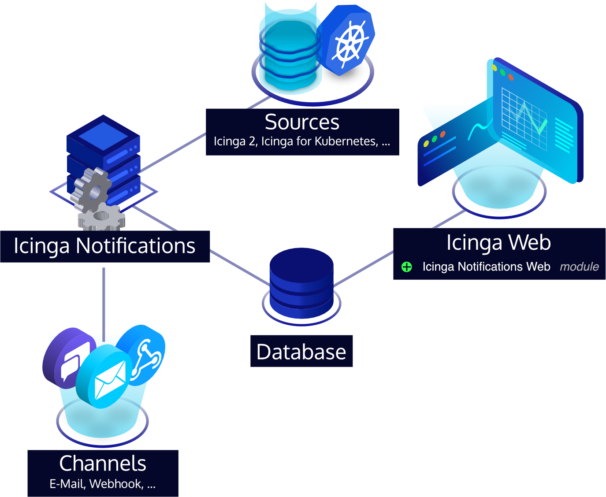

# Icinga Notifications Web

Icinga Notifications is a set of components that processes received events from various sources, manages
incidents and forwards notifications to predefined contacts. The components are:

* [Icinga Notifications](https://icinga.com/docs/icinga-notifications/latest/doc/01-About/), the daemon, which
  receives events and sends notifications.
* Icinga Notifications Web, this module for Icinga Web, which lets administrators configure Icinga Notifications and
  analyze its behavior.
* Sources, such as Icinga DB or Icinga for Kubernetes, which submit events to the daemon.

## Big Picture

Sources submit events to the Icinga Notifications daemon. The daemon evaluates these events against the configured
event rules and decides whether to open an incident, when to escalate it and who to notify through which channel.
The configuration resides in a database shared by the daemon and Icinga Notifications Web.

Icinga Notifications Web is the place to configure contacts, schedules, event rules and channels, and to look up
incidents and sent notifications. Most of the configuration is done here. Sources that are maintained by an
integration, such as Icinga DB Web, are the exception. The integration creates and updates them itself, so Icinga
Notifications Web shows them read-only. For other sources, you set up the credentials here.

Compatible sources are, for example:

* Icinga 2, by using Icinga DB as backend
* Icinga for Kubernetes

Any other software that can submit events to the
[HTTP API](https://icinga.com/docs/icinga-notifications/latest/doc/20-HTTP-API/) of the daemon can act as a source
as well.

### Who Uses What

Sources can embed notification components into their own views. Icinga DB Web, for example, shows recipients and
subscribers in addition to the previously configured contacts. A host's or service's history also embeds sent
notifications in relation to their originating events.

**Day-to-day incident management is meant to happen in the web integration of the source.**
The views of Icinga Notifications Web are primarily designed for **administrators**. They use them to:

* set up contacts, schedules, event rules, channels and sources
* analyze the behavior of the system: why was whom notified, when and through which channel

!!! warning

    Authorization in Icinga Notifications Web is not fully functional. Restricting users to certain objects is not
    supported. Only grant access to the module to users who are allowed to see **all** events and incidents.
    Regular users should work with incidents through the web integration of the source instead, where the
    restrictions of the source apply. See [Access Control](03-Configuration.md#access-control) for details.

## Concepts

The documentation uses the following terms consistently.

| Term                 | Description                                                                                                                          |
|----------------------|--------------------------------------------------------------------------------------------------------------------------------------|
| Source               | A system that submits events to Icinga Notifications, e.g. Icinga DB. It authenticates with a username and password or a client certificate. |
| Source type          | The kind of a source, e.g. Icinga DB. Event rules are bound to a source type, not to an individual source.                          |
| Event                | A message from a source about something that happened to an object, e.g. a state change of a service or an acknowledgement.          |
| Incident             | The lifecycle of a problem for an object. It opens when an event reports a problem and closes when the object has recovered.        |
| Severity             | The importance of an incident or event. Possible values are _Ok_, _Warning_, _Error_ and _Critical_.                                 |
| Event rule           | Defines which events are routed to whom. There are escalation rules and notification rules.                                          |
| Escalation rule      | An event rule tied to the lifecycle of an incident. It notifies recipients in stages.                                                |
| Notification rule    | An event rule that notifies a fixed set of recipients as soon as an event matches, independent of incidents.                         |
| Escalation           | One stage of an escalation rule. It has a condition, e.g. the incident age or severity, and recipients that are notified once it is met. |
| Recipient            | A contact, contact group or schedule that is notified by an escalation or by a notification rule.                                    |
| Contact              | A person to notify, with an address for each channel and a default channel.                                                          |
| Contact group        | A named set of contacts.                                                                                                             |
| Schedule             | Assigns contacts and contact groups to points in time, e.g. for on-call duty. A schedule is made of rotations.                       |
| Rotation             | A pattern in a schedule that lets its members take turns. Multiple rotations with different priorities can overlap.                  |
| Channel              | A transport for notifications, e.g. email. Channels are provided by the daemon and configured in Icinga Notifications Web.           |
| Manager              | The user who is responsible for an incident. An incident has at most one manager.                                                    |
| Subscriber           | A user who subscribed to an incident to follow it. Subscribers are listed separately from recipients.                                                |

## Available Channels

The following channels are available out of the box:

* _email_: Email submission via SMTP
* _telegram_: Telegram
* _webhook_: Configurable HTTP/HTTPS queries for third-party backends

The options of each channel are provided by the daemon. See the
[channel documentation](https://icinga.com/docs/icinga-notifications/latest/doc/10-Channels/) of Icinga Notifications
for details. Additional custom channels can be developed independently of Icinga Notifications, following the
[channel specification](https://icinga.com/docs/icinga-notifications/latest/doc/10-Channels/#technical-channel-description).

## Installation

To install Icinga Notifications Web, see [Installation](02-Installation.md).

## License

Icinga Notifications Web and its documentation are licensed under the terms of the
[GNU General Public License Version 3](https://www.gnu.org/licenses/gpl-3.0-standalone.html).
