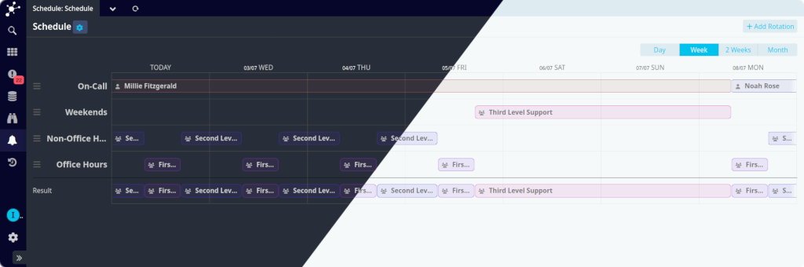

# Configuration



If Icinga Web has been installed but not yet set up, please visit Icinga Web and follow the web-based setup wizard.
For Icinga Web setups already running, log in to Icinga Web with a privileged user and follow the steps below to
configure Icinga Notifications Web:

<!--  -->

## Module Activation

If you just installed Icinga Notifications Web, remember to activate it on your Icinga Web instance(s):

- Use Icinga Web's command-line interface on the webserver(s) and execute `icingacli module enable notifications`.
- Visit Icinga Web, log in as a privileged user and enable the module under `Configuration →
  Modules → notifications` by switching the state from `disabled` to `enabled`.

<!--  -->

## Access Control

Sources can embed notification components in their own views. Icinga DB Web, for example, shows incidents, sent
notifications and the actions to manage or subscribe to an incident next to hosts and services. **Day-to-day incident
management happens in the web integration of the source.** The views of Icinga Notifications Web are primarily
designed for administrators: to set up the configuration and to analyze the behavior of the system, i.e. why was whom
notified, when and through which channel.

!!! warning

    Authorization mechanics in the current release are not fully functional. For example, restricting users to certain
    objects is not supported. Do not grant users access to the module unless you are sure they are authorized to see
    **all** events and incidents. This applies in particular to the permissions `notifications/view/incidents` and
    `notifications/view/history`.

Regular users should work with incidents through the web integration of the source instead. The restrictions of the
source apply there.

### Permissions

| Permission                       | Description                                                                              |
|----------------------------------|------------------------------------------------------------------------------------------|
| notifications/view/incidents     | Allow to view incidents. Shows the menu entry `Notifications → Incidents`.               |
| notifications/view/history       | Allow to view the history of notifications. Shows the menu entry `Notifications → History`. |
| notifications/view/contacts      | Allow to view contacts                                                                   |
| notifications/config/schedules   | Allow to configure schedules                                                             |
| notifications/config/event-rules | Allow to configure event rules                                                           |
| notifications/config/contacts    | Allow to configure contacts and contact groups                                           |
| notifications/api                | Allow to modify configuration via API                                                    |

Channels, sources and the database connection are part of the module configuration. Users need the Icinga Web
permission `config/modules` to access them.

!!! info

    Roles that were created before v1.0 need the permissions `notifications/view/incidents` and
    `notifications/view/history` to keep seeing incidents. See [Upgrading](05-Upgrading.md) for details.

## Database Configuration

Connection configuration for the database, which both,
[Icinga Notifications](https://github.com/Icinga/icinga-notifications) and
[Icinga Notifications Web](https://github.com/Icinga/icinga-notifications-web), use.

!!! tip

    If not already done, initialize your database by following these
    [instructions](https://icinga.com/docs/icinga-notifications/latest/doc/02-Installation#setting-up-the-database).

1. Create a new resource for the Icinga Notifications database via the `Configuration → Application → Resources` menu.
2. Configure the resource you just created as the database connection for Icinga Notifications Web using the
   `Configuration → Modules → notifications → Database` menu.

For the options of the daemon, such as its database connection, the listener and data retention, see the
[Icinga Notifications configuration](https://icinga.com/docs/icinga-notifications/latest/doc/03-Configuration/).

## Channels Configuration

As the Icinga Notifications daemon notifies contacts in case of events and incidents, you need to configure
appropriate communication channels.

The available channel types are listed [here](01-About.md#available-channels). The daemon provides them together with
their options, so the options shown in the form depend on the installed channels. Some options are only shown if
another option has a certain value, e.g. the SMTP authentication or TLS settings of the email channel. Refer to the
[channel documentation](https://icinga.com/docs/icinga-notifications/latest/doc/10-Channels/) of Icinga Notifications
for details about each channel.

Channels are configured through `Configuration → Modules → notifications → Channels`. The list indicates whether the
configuration of a channel is valid. If it is not, the reason is shown below the channel's name.

!!! note

    If the list of channel types is empty, make sure Icinga Notifications is running. It registers the available
    channel types in the database when it starts.

You need to configure at least one valid communication channel to fully configure Icinga Notifications Web.

## Sources Configuration

Sources are the most vital part of Icinga Notifications. Without them, no events will be processed and no
notifications will be sent. A source can be set up in two ways:

* Sources that are **maintained by an integration**, such as Icinga DB Web, are created and updated by it. They are
  shown as locked and read-only in Icinga Notifications Web. You can still delete them. As this may cause malfunction
  until the integration is disabled, you are warned before.
* Other sources are configured manually. No integration is required.

Sources are configured through `Configuration → Modules → notifications → Sources`.

### Adding a Source Manually

1. Navigate to `Configuration → Modules → notifications → Sources` and click on `New Source`.
2. Enter a `Source Name` and the `Source Type`, as stated in the documentation of the source.
   Event rules are bound to the source type, not to an individual source.
3. Choose the `Authentication Type`:
    * `Username and password`: Define a username and a password of at least 16 characters.
      The username must be unique.
    * `Client certificate`: Enter the subject of the TLS client certificate the source presents,
      e.g. `CN=source.example.com,OU=Monitoring,O=Icinga,C=DE`. The subject must be unique.
4. Click on `Create Source` and add the credentials to the configuration of the source.

Authentication with a client certificate requires TLS on the listener of Icinga Notifications. See the
[listener configuration](https://icinga.com/docs/icinga-notifications/latest/doc/03-Configuration/#http-api-configuration)
for the required options. The same page describes how local sources can submit events through a Unix socket. They
are identified by their operating system user, which is matched against the username of the source.

Deleting a source stops the processing of its events. If it is the last source of its type, all event rules for that
type are deleted as well.

### Adding Icinga DB as a Source

Icinga DB Web creates and maintains the source for Icinga DB, if it is installed on the same system alongside Icinga
Notifications. To enable it, navigate to `Configuration → Modules → icingadb → General Settings`, and switch on
`Enable notifications` in the section _Icinga Notifications_. Because Icinga DB Web maintains the source, it appears
as locked in Icinga Notifications Web.

For a detailed explanation, see https://icinga.com/docs/icinga-db-web/latest/doc/03-Configuration/.

## General Configuration

The configuration file is located at `/etc/icingaweb2/modules/notifications/config.ini` by default.
The following settings can be configured, but currently only by adjusting the configuration file directly.
Settings go into the section `[settings]`.

### Available Settings and defaults

| Option                         | Description                                                         | Default   |
|--------------------------------|---------------------------------------------------------------------|-----------|
| event_message_character_limit  | Sets the maximum number of characters to display in event messages. | **10000** |

### Example

Setting the event message character limit to 500000.

```ini
[settings]
event_message_character_limit = 500000
```

The same file contains the `[database]` section, which is written by the database configuration, and the optional
`[daemon]` section for [desktop notifications](06-Desktop-Notifications.md#configure-the-daemon).
